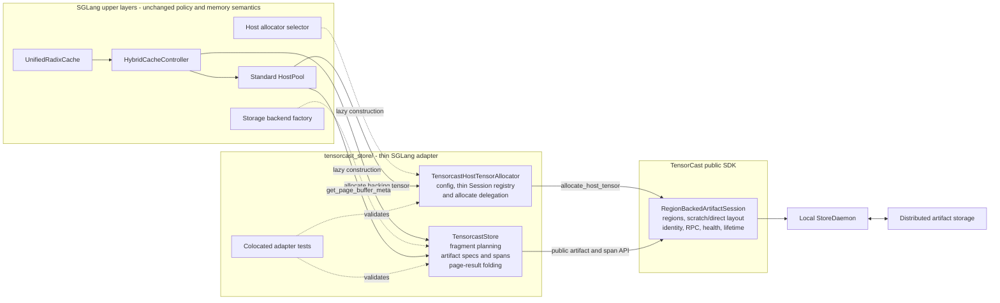
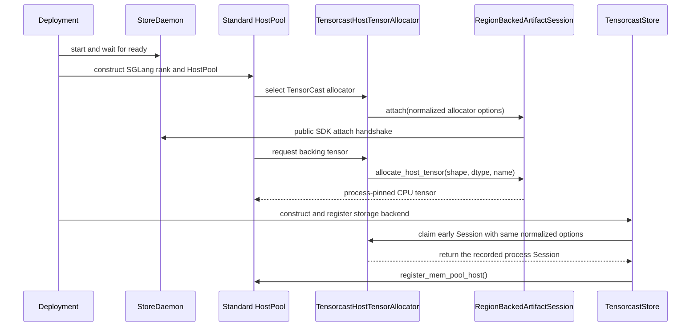
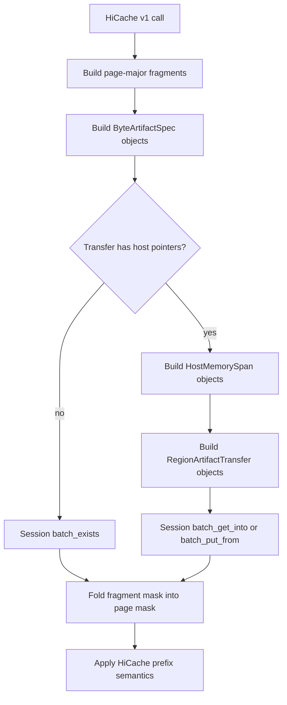
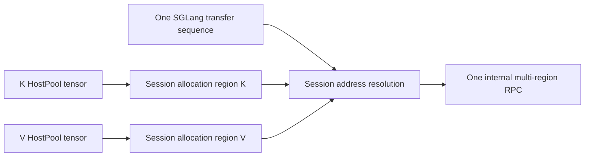

# TensorCast HiCache Backend Design

## Status

- Status: accepted implementation design, revised for the public TensorCast
  `RegionBackedArtifactSession`
- Target branch: `feat/tensorcast-kv-backend`
- Upstream baseline: current SGLang `main`
- Existing pull request to update: <https://github.com/sgl-project/sglang/pull/27265>
- Historical implementation branch: `feat/tensorcast-kv-backend-deprecated`
- TensorCast SDK dependency: the public `tensorcast.api.store`
  `RegionBackedArtifactSession` surface defined by TensorCast design `0122`
- Initial scope: `UnifiedRadixCache`, `FULL` KV component only
- HiCache storage interface: synchronous page-oriented v1 API
- Supported transfer modes:
  - allocator-backed direct L2/L3 mode, the default; and
  - scratch-slab staging mode.

This document is normative for the new implementation. The deprecated PR branch
is a source of tests, naming conventions, and operational experience only. Its
raw daemon client, protobuf construction, HostPool layout changes, region
binding exposure, and slot-state changes must not be copied into the new branch.

## 1. Executive Summary

TensorCast is integrated as an ordinary page-oriented HiCache L3 backend. The
SGLang implementation is a thin adapter over TensorCast's public,
process-scoped `RegionBackedArtifactSession`:

1. `UnifiedRadixCache` and `HybridCacheController` continue to own cache
   policy, tree state, HostPool slot allocation, scheduling, and
   acknowledgements.
2. Existing HostPool implementations continue to own page layout and expose
   page pointers through `get_page_buffer_meta()`.
3. In allocator mode, a thin `TensorcastHostTensorAllocator` delegates physical
   HostPool tensor allocation to `session.allocate_host_tensor()`.
4. `TensorcastStore` expands a logical FULL KV page into K/V or KV fragments,
   constructs public TensorCast artifact specs and owned host spans, invokes
   Session batch methods, and folds fragment outcomes into HiCache page results.
5. The TensorCast SDK owns daemon attachment, artifact-ID derivation, region
   registration and mapping, multi-region address resolution, scratch arenas,
   protobuf layouts, slot wire tokens, operation IDs, retries, response
   validation, sticky RPC health, and process-pinned region lifetime.

The central page-layout decision remains unchanged: one logical MHA page is
represented by separate contiguous K and V artifacts. A logical MLA page is one
contiguous KV artifact. The integration must not add a TensorCast-specific
HostPool layout or alter the standard K/V tensor ordering.

Both transfer modes use the same SGLang data path and artifact schema. The
Session decides whether submitted host spans are copied through its private
scratch arenas or resolved directly into Session-allocated regions.

SGLang must never construct a canonical TensorCast artifact ID, daemon request,
`TargetLayout`, region handle, storage ID, slot index, or slot generation. Those
are TensorCast SDK implementation details.

## 2. Hard Ownership and Import Boundaries

Except for the minimum wiring, registration, argument exposure, and generic
configuration routing needed to select the backend, all TensorCast-specific
SGLang implementation code and tests **MUST** be located in:

```text
python/sglang/srt/mem_cache/storage/tensorcast_store/
```

The backend may import TensorCast symbols only from the public re-export:

```python
from tensorcast.api.store import (
    AllocatorTransferOptions,
    ByteArtifactKeyspace,
    ByteArtifactSpec,
    HostMemorySpan,
    RegionArtifactExistsResult,
    RegionArtifactInputError,
    RegionArtifactTransfer,
    RegionArtifactTransferResult,
    RegionBackedArtifactSession,
    RegionBackedArtifactSessionOptions,
    RegionSessionAttachError,
    RegionSessionFailedError,
    RegionSessionFailureCode,
    RegionSessionHealth,
    RegionSessionTerminatedError,
    ScratchTransferOptions,
)
```

Production SGLang code must not import or access:

- `tensorcast.daemon_ctl`;
- `tensorcast.proto.*` or generated protobuf classes;
- `tensorcast.api.store.runtime`;
- TensorCast identity or selection builders;
- private TensorCast modules or attributes whose names begin with `_`;
- region handles, attachment tokens, file descriptors, or mmap objects;
- `TargetLayout`, `StorageEntry`, or `TargetTensorOffset`; or
- raw daemon status codes.

In particular, the implementation must not add TensorCast-specific behavior to:

- `unified_radix_cache.py`;
- `unified_cache/`;
- `pool_host/base.py`;
- `pool_host/mha.py`;
- `pool_host/mla.py`;
- `pool_host/group.py`;
- the legacy `memory_pool_host.py`;
- `hiradix_cache.py`; or
- top-level SGLang test directories.

The only permitted changes outside `tensorcast_store/` are thin integration
points:

| External file or area | Permitted change |
|---|---|
| `server_args.py` | Add `tensorcast` as a storage-backend choice. |
| `storage/backend_factory.py` | Lazily register and construct `TensorcastStore`. |
| `managers/cache_controller.py` | Select the existing synchronous v1 zero-copy callbacks for the backend. No TensorCast data-path or failure logic. |
| `pool_host/common.py` | Add one lazy allocator-factory branch. Parsing and allocator behavior remain under `tensorcast_store/`. |
| `arg_groups/hicache_hook.py` | Validate supported mode/layout combinations if generic argument validation requires it. |
| dependency/package metadata | Declare the optional TensorCast dependency if required. |

An external change is out of scope if it introduces any of the following:

- a TensorCast Session, region handle, offset, or artifact spec added directly
  to a HostPool class or exposed through a new HostPool property; the existing
  generic `allocator` property may hold the backend-local allocator adapter;
- a TensorCast-specific HostPool property;
- a K/V layout branch selected by TensorCast;
- callbacks from `HostKVCache.alloc()`, `free()`, or `clear()` into TensorCast;
- TensorCast state in Unified tree nodes;
- TensorCast locks, generations, or pin counts in upper layers; or
- TensorCast tests outside the backend package.

This boundary is an acceptance criterion, not merely a preference.

## 3. Scope

### 3.1 In scope

- Latest `UnifiedRadixCache` only.
- The base `FULL` KV component carried by the v1 HiCache API:
  - `batch_exists()`;
  - `batch_get_v1()`; and
  - `batch_set_v1()`.
- Standard MHA host pools with equal K/V head dimensions.
- Asymmetric MHA host pools with separate K and V tensors.
- Standard MLA FULL KV host pools.
- `page_first` and `page_first_direct` host layouts.
- Allocator-backed direct mode through Session-owned host tensors.
- Scratch mode through Session-owned fixed-capacity arenas.
- One TensorCast Session and one StoreDaemon attachment per SGLang rank/process.
- A single Session transfer batch spanning multiple regions.
- TP/PP-scoped artifact engine keys matching existing HiCache semantics.
- Linux with the CUDA hardware backend. Both transfer modes use this same
  initial platform boundary.
- `--hicache-host-memory-mode=cache`; the HostPool is a persistent L2 cache in
  the initial integration.
- Lazy imports so SGLang imports successfully without TensorCast installed.
- Backend-local conversion of a fatal Session into a permanently unavailable L3
  path without terminating the SGLang process.

### 3.2 Explicitly out of scope for the initial PR

- Legacy `HiRadixCache` integration.
- Unified SWA, Mamba, DSA/indexer, draft, or other sidecar components.
- HiCache storage v2 (`batch_*_v2`) transfers.
- A TensorCast-specific host-memory layout.
- `layer_first` MHA direct storage.
- `page_head`, split-head, TP-LCM, attention-CP, or DCP-aware storage.
- `--hicache-host-memory-mode=buffer_only` and its transient staging-pool
  pipeline.
- Asynchronous TensorCast calls that outlive a v1 storage method.
- First-time runtime attachment of TensorCast after HostPool construction. The
  initial backend must be selected in the rank's startup configuration.
- In-process recovery of a failed Session.
- Switching transfer modes in a live rank.
- Retrofitting allocator mode onto a HostPool that was constructed with the
  ordinary allocator.
- Detaching and reattaching TensorCast in the same process.
- Starting, stopping, supervising, or restarting StoreDaemon from SGLang.
- A new lifecycle API on upstream `HostTensorAllocator`.
- Fixing the generic SGLang shutdown-ordering issue in which HostPool
  destruction may precede storage detach.
- Strict cancel-and-drain guarantees after an ambiguous direct RPC failure.
- Compatibility with artifacts written by the deprecated whole-page schema.

Support for a future component must be added through backend-local fragment
adapters, not by weakening the ownership boundary above.

The initial backend intentionally inherits
`HiCacheStorage.register_mem_host_pool_v2()`. Consequently, a sidecar exposed
through `HostPoolGroup` may be recorded by the generic controller even though
TensorCast does not support transferring it. The first `batch_*_v2()` call for
such an operation raises `NotImplementedError` through the existing unsupported
API surface and may terminate the calling storage worker. This is an explicit
initial-scope limitation: the supported FULL v1 failure-containment guarantee
does not extend to a configuration that requires storage v2. The PR does not
add upper-layer capability negotiation or change Hybrid controller startup
ordering to reject that configuration earlier.

## 4. Architecture and Responsibility Split



The ownership split is:

| Concern | Owner |
|---|---|
| Radix-tree policy and logical cache nodes | `UnifiedRadixCache` |
| Host page indices, free lists, allocation, and reuse | Existing HostPool |
| FULL page component schema | `TensorcastStore` fragment planner |
| Rank/component engine-key meaning | `TensorcastStore` |
| Logical-page success and prefix folding | `TensorcastStore` |
| Physical allocator delegation | `TensorcastHostTensorAllocator` |
| Early attach, Store ownership claim, and terminal adapter admission | Thin process registry in `host_allocator.py` |
| Canonical artifact identity and selection | TensorCast Session |
| Scratch allocation, packing, and copy | TensorCast Session |
| Direct region allocation and address resolution | TensorCast Session |
| Multi-region target layout and slot wire tokens | TensorCast Session |
| RPC retry, timeout, validation, and sticky health | TensorCast Session |
| Region mapping retention and daemon PID cleanup contract | TensorCast Session and StoreDaemon |

Mooncake remains the architectural reference for keeping Unified and HostPool
policy backend-agnostic. TensorCast differs at the physical-memory boundary:
Mooncake exposes its own allocator and transfer API, whereas TensorCast now
encapsulates allocator regions and transfer protocol behind one public Session.

## 5. Package Layout

Follow the compact organization of `mooncake_store/`. The initial
implementation has two substantive Python modules:

```text
tensorcast_store/
├── design.md
├── tensorcast_store.py           # public-Session HiCache adapter
├── host_allocator.py             # config and allocation delegation
├── README.md                     # user-facing setup
├── configs/                      # example daemon/global-store configs
├── test_tensorcast_store.py
└── test_tensorcast_host_allocator.py
```

As with `mooncake_store/`, this directory is an implicit namespace package and
does not contain an `__init__.py`. Callers import the concrete modules directly;
an empty package initializer would provide no API or lazy-import behavior.

Small dataclasses, fragment planners, engine-key helpers, folding helpers, and
failure-policy helpers remain private to `tensorcast_store.py`. Configuration
normalization and Session-options construction live in `host_allocator.py`
because allocator mode needs them before backend construction.

Do not create SGLang modules for TensorCast clients, layouts, regions, slot
tokens, or identity construction. Those abstractions already exist inside the
TensorCast SDK.

TensorCast imports remain lazy. Importing SGLang, HostPool modules, or the
backend factory must not import TensorCast unless `tensorcast` is selected.

## 6. Terminology

- **Logical page**: the unit identified by one HiCache key and represented by
  one boolean in the v1 API.
- **Fragment**: one contiguous byte component of a logical page. MHA has K and
  V fragments; MLA has one KV fragment.
- **Fragment schema**: the ordered component names and byte lengths determined
  from the registered HostPool/layout.
- **Engine key**: opaque bytes supplied by SGLang to TensorCast for one
  fragment. TensorCast derives the canonical artifact ID from it and the
  keyspace.
- **Artifact spec**: public `ByteArtifactSpec` containing a keyspace, engine
  key, and expected byte length.
- **Host span**: public `HostMemorySpan` borrowing a contiguous HostPool range
  for one synchronous Session call.
- **Allocator mode**: HostPool backing tensors are allocated by the Session and
  used directly for L2/L3 transfer.
- **Scratch mode**: HostPool uses the ordinary allocator and the Session stages
  transfer through its private scratch arenas.
- **Process Session**: the one `RegionBackedArtifactSession` attached by one
  SGLang rank/process to one node-local StoreDaemon.

Region IDs, storage entries, slot geometry, wire tokens, and RPC generations
are deliberately absent from SGLang terminology.

## 7. Configuration Schema

Backend-specific configuration is namespaced under `tensorcast`. Except for
`daemon_address`, every initial field has an explicit default or a deterministic
SGLang-derived default. Allocator-backed direct mode is the default.

Generic HiCache controller fields remain top-level. The backend-local parser
reads only the nested `tensorcast` object and treats every sibling field as
controller-owned. It rejects unknown fields inside the `tensorcast` object.

### 7.1 Normative shape

```json
{
  "prefetch_threshold": 256,
  "prefetch_timeout_base": 1.0,
  "prefetch_timeout_per_ki_token": 0.25,
  "hicache_storage_pass_prefix_keys": false,
  "tensorcast": {
    "daemon_address": "127.0.0.1:8073",
    "namespace": "default",
    "transfer_mode": "allocator",
    "model_id": null,
    "model_version": "unversioned",
    "session_name_prefix": "sglang",
    "region_name_prefix": "sglang_tensorcast",
    "exists_timeout_s": 30.0,
    "transfer_timeout_s": null,
    "scratch": {
      "capacity_bytes": 16777216
    }
  }
}
```

The full extra-config value may use the inline or `@path` forms already
supported by HiCache. JSON, YAML, and TOML parsing remains generic SGLang
behavior; TensorCast config normalization has one backend-local implementation.
That implementation returns an immutable, validated `TensorcastConfig` model.
At this stage `model_id` remains explicitly supplied or `None`; resolving a
`None` value requires the later `HiCacheStorageConfig` and is an artifact
identity operation, not Session configuration. The parser accepts either the
original serialized/path value or an already parsed mapping, reads only the
nested backend object, fills every backend default, and never inspects or
mutates sibling fields owned by `HybridCacheController`.

### 7.2 Fields and defaults

| Field | Type | Default | Meaning |
|---|---:|---:|---|
| `tensorcast.daemon_address` | string | required | StoreDaemon gRPC endpoint passed unchanged to the Session, for example `127.0.0.1:8073`. |
| `tensorcast.namespace` | non-empty string | `default` | TensorCast byte-artifact namespace. |
| `tensorcast.transfer_mode` | enum | `allocator` | `allocator` or `scratch`. |
| `tensorcast.model_id` | string or null | SGLang `storage_config.model_name` | Stable logical model identity. An explicit non-empty value overrides the SGLang-derived value. |
| `tensorcast.model_version` | non-empty string | `unversioned` | Immutable model/config revision used in artifact identity. Production deployments should supply a release- or content-specific value. |
| `tensorcast.session_name_prefix` | non-empty string | `sglang` | Base for the diagnostic Session name. SGLang always appends the process's world-rank label. It is not artifact identity. |
| `tensorcast.region_name_prefix` | non-empty string | `sglang_tensorcast` | Base for diagnostic region names. SGLang always appends the process's world-rank label before passing it to the Session. |
| `tensorcast.exists_timeout_s` | positive float | `30.0` | Metadata-only exists deadline. |
| `tensorcast.transfer_timeout_s` | positive float or null | `null` | Region transfer deadline passed unchanged to the Session. Null keeps the SDK's default no-deadline behavior. |
| `tensorcast.scratch.capacity_bytes` | positive int | `16777216` | Capacity of each Session-owned scratch direction arena; fixed at attach and used only in scratch mode. |

SGLang does not normalize or validate the endpoint syntax. Deployment supplies
a valid daemon address, and endpoint errors surface from the Session attach.
The daemon's separate local FD-handoff socket is discovered and validated by
the Session attach handshake; it is not the configured `daemon_address`.

If both `tensorcast.model_id` and SGLang's model name are absent or empty,
configuration fails before artifact operations begin. The parser never sends an
empty model ID to `ByteArtifactKeyspace`.

The scratch default is a valid Session configuration, not a promise that it is
large enough for every model. Its model-specific lower bound is unavailable
until HostPool construction and fragment registration have exposed the real
per-page byte lengths. Section 12.4 defines the mandatory registration-time
validation and diagnostic.

The initial integration deliberately has no configuration for:

- policy profiles;
- region TTL;
- separate get/put scratch region names;
- a caller-configurable artifact-layout schema version;
- allocator region handles or sizes;
- stable-backing activation;
- slot geometry or generation;
- transparent retries; or
- a `require_quiescent_return` assertion.

Those are either fixed Session semantics or TensorCast implementation details.

### 7.3 Mapping to public Session options

The shared normalizer first derives a rank-distinguishing diagnostic label from
SGLang's published parallel context:

```python
parallel = get_parallel()
rank_label = f"rank{parallel.world_rank}of{parallel.world_size}"
effective_session_name = f"{config.session_name_prefix}-{rank_label}"
effective_region_name_prefix = f"{config.region_name_prefix}-{rank_label}"
```

For example, world rank 3 of an eight-rank SGLang instance uses
`session_name="sglang-rank3of8"` and
`region_name_prefix="sglang_tensorcast-rank3of8"`. TensorCast also includes
the owner PID and allocation sequence in concrete region names, so two SGLang
instances on the same node remain distinct even when they have the same world
rank.

The normalizer then constructs exactly one transfer option:

```python
if config.transfer_mode == "allocator":
    transfer = AllocatorTransferOptions()
else:
    transfer = ScratchTransferOptions(
        capacity_bytes=config.scratch.capacity_bytes,
    )

options = RegionBackedArtifactSessionOptions(
    daemon_address=config.daemon_address,
    session_name=effective_session_name,
    transfer=transfer,
    transfer_timeout_s=config.transfer_timeout_s,
    exists_timeout_s=config.exists_timeout_s,
    region_name_prefix=effective_region_name_prefix,
)
```

Session setup and artifact identity use two deliberately separate stages:

1. The allocator path normalizes `TensorcastConfig`, derives the rank-local
   diagnostic names, builds Session options, attaches the Session, and records
   it in the thin backend-local process registry. Identity-only fields such as
   `namespace`, `model_id`, and `model_version` are validated but do not enter
   Session options.
2. `TensorcastStore` normalizes the same backend mapping, builds the same
   Session options, and claims the already attached Session from the thin
   registry. During `register_mem_pool_host()` it resolves
   `effective_model_id` from an explicit `config.model_id` or the now-available
   `storage_config.model_name`, then constructs the artifact keyspace.

The Store path must not call the SDK to perform the first process attach. The
thin registry rejects Store construction if the allocator path did not already
record the Session, which enforces the no-first-time-runtime-attach rule in both
allocator and scratch modes.

Allocator construction and Store construction must still call the same config
and Session-options builders. The following operational fields must agree:

- transfer mode;
- scratch capacity in scratch mode;
- transfer timeout; and
- exists timeout.

`session_name` and `region_name_prefix` are diagnostic first-attacher values in
the SDK. Allocator and Store construction must use the same backend-local rank
helper so every attach supplies identical effective values without threading
rank-specific configuration through HostPool constructors.

Normalization is idempotent: normalizing the same source twice produces equal
`TensorcastConfig` and Session options before effective model-ID resolution.
This is required because the allocator path sees the globally published raw
extra-config before HostPool construction, whereas `TensorcastStore` may
receive the controller's already parsed backend mapping later. Neither call
site owns an alternate parser or a second set of defaults. Resolving
`model_id=None` later does not change Session options or the process Session
fingerprint.

### 7.4 Supported configuration matrix

| Host-memory mode | Transfer mode | Host layout | L1/L2 I/O backend | L2/L3 path | Result |
|---|---|---|---|---|---|
| `cache` | `allocator` | `page_first` | `kernel` | Session direct | supported, default |
| `cache` | `allocator` | `page_first_direct` | `direct` | Session direct | supported |
| `cache` | `scratch` | `page_first` | `kernel` | Session scratch copy | supported |
| `cache` | `scratch` | `page_first_direct` | `direct` | Session scratch copy | supported |
| `cache` | either | `layer_first` MHA | any | many per-layer fragments | rejected initially |
| `cache` | either | `page_head` or split-head | any | split-head schema | rejected initially |
| `buffer_only` | either | any | any | transient staging pool | rejected initially |

Transfer mode controls only L2/L3 memory movement. It must not silently alter
the HostPool layout or `--hicache-io-backend`.

The complete initial matrix additionally requires
`--hicache-host-memory-mode=cache`, Linux, and SGLang's CUDA hardware backend.
The backend-local allocator factory rejects `buffer_only` and unsupported
platforms before Session attachment or HostPool allocation. In particular,
allocator mode must not run through an accelerator-specific HostPool allocation
function that ignores the selected `HostTensorAllocator`. Buffer-only, ROCm,
NPU, MUSA, XPU, and other configurations require their own validation and
end-to-end coverage before this restriction can be relaxed.

Transfer mode is a startup invariant. The first Session attach fixes it for the
entire rank process. The initial integration requires both modes to be selected
before HostPool construction. A later control-plane request cannot attach
TensorCast for the first time to an already constructed HostPool, even in
scratch mode. The startup controller may internally reuse SGLang's generic
`attach_storage_backend()` implementation; that call is still a startup attach
because TensorCast was selected before the HostPool allocator factory ran.

Once TensorCast is enabled, SGLang's generic same-backend attach behavior is an
idempotent policy update: it returns success after applying the supplied
prefetch/write policies and does not parse or apply the new backend-extra
configuration. Consequently, a daemon address, transfer mode, timeout, or
other TensorCast option supplied by such a request is ignored rather than
rejected, and the process Session remains unchanged. TensorCast adds no
upper-layer comparison or alternate runtime-update path for the initial PR.

There is no automatic allocator-to-scratch fallback. If allocator mode cannot
attach or allocate, rank startup fails with a precise error.

## 8. Session Attachment and Startup

StoreDaemon is an external prerequisite. The deployment starts Global Store
and StoreDaemon, waits for StoreDaemon readiness, and only then starts the
SGLang rank. SGLang never launches, supervises, restarts, or shuts down the
daemon.

The Session attach handshake owns the following checks; SGLang does not
duplicate them:

- StoreDaemon responds;
- daemon startup phase is ready;
- CPU shared memory is enabled;
- the local handle service exists and is reachable; and
- the endpoint is node-local.

The handshake intentionally checks only these basic capabilities. Direct
byte-artifact transfers can switch to TensorCast's `batch_payload_ref`
transport as the serialized batch grows. When the daemon publishes a
capability directory, a nonzero active capability-token version and a nonempty
secret are therefore deployment prerequisites; otherwise a small transfer may
work while a larger `batch_get_into()` fails when it first needs payload refs.
The checked-in daemon configuration contains a fixed key only for local
single-node validation. Production deployments must replace it with
independently generated secret material. The initial adapter does not inspect
daemon configuration or duplicate this validation in SGLang.

The SGLang process and StoreDaemon must observe the same owner PID. Container
deployments must therefore share a PID namespace or provide an equivalent
daemon-visible PID arrangement. The rank must not fork or spawn children after
attaching the Session.

Both transfer modes perform their first Session attach from the backend-local
allocator factory during HostPool construction. This catches daemon readiness
and Session-option errors before the rank finishes allocating its L2 HostPool.
The thin backend-local registry retains that Session. `TensorcastStore` later
claims it with identical normalized options rather than independently creating
or first-attaching a Session.

### 8.1 Allocator-mode ordering

Allocator mode affects physical HostPool construction, so its first attach
occurs before `TensorcastStore` exists. It does not predict one aggregate
capacity. The HostPool has already calculated the exact shape and dtype of each
backing tensor when it calls `HostTensorAllocator.allocate()`, and the adapter
delegates that exact request to `session.allocate_host_tensor()`. The SDK then
creates one exact-size region per allocation:



Every allocator instance in the rank converges on the same Session. Multiple
allocations, including separate asymmetric K/V tensors, become independent
Session-owned regions in its private registry.

### 8.2 Scratch-mode ordering

Scratch mode uses the ordinary upstream `HostTensorAllocator`, but its
backend-local allocator factory still normalizes the configuration and calls
`RegionBackedArtifactSession.attach()` before returning that allocator. The
configured `scratch.capacity_bytes` is therefore fixed at the same HostPool
construction point as allocator mode.

This early attach does not allocate scratch memory and does not change physical
HostPool allocation. The Session creates its get and put arenas lazily on the
first transfer in each direction. Once `TensorcastStore` registers the finished
HostPool, SGLang can calculate and validate the exact minimum capacity from the
registered fragment schema as specified in Section 12.4.

### 8.3 Thin SGLang Session registry

`host_allocator.py` owns one small process-local registry protected by a normal
`threading.Lock`. It exists only to bridge SGLang's early HostPool allocator
phase and later Store phase. Its state is limited to:

```text
session
normalized Session options
early_attach_completed
active_store_owner
terminal
```

The registry:

- performs or returns the early Session attach requested by each HostPool
  allocator factory;
- rejects conflicting normalized Session options;
- lets exactly one `TensorcastStore` claim the recorded Session;
- rejects Store construction when no early attach occurred;
- records terminal Store close so a new Store cannot claim the Session; and
- never tracks regions, spans, artifacts, slots, RPC generations, operation
  IDs, or Session health.

Store ownership claim is constructor-exception-safe. `TensorcastStore.__init__`
completes every fallible normalization and local-field initialization before
claiming the registry. The claim is its final stateful construction step; after
it succeeds, the constructor performs no operation that can fail. This prevents
a constructor exception from leaving an owner claim that the controller cannot
close because no Store object was returned. Failures during the later
`register_mem_pool_host()` call follow the controller's existing rollback path,
which closes the fully constructed Store.

It is a thin SGLang lifecycle/admission registry, not a replacement for the
SDK's process Session registry or sticky RPC-health state. Scratch mode needs
this explicit record because its factory returns an ordinary
`HostTensorAllocator` that otherwise carries no reference proving that the
early attach occurred. The allocator may retrieve the Session for allocation
but may not claim Store ownership or terminate it.

The registry has no production or test-only reset operation. Resetting it in
place would contradict the same-process non-recovery guarantee and could hide
lifecycle defects. Tests that need a fresh lifecycle use fresh processes as
specified in Section 20; they do not clear this registry or TensorCast SDK
private state.

### 8.4 Attach failure

`RegionSessionAttachError` or allocator-region setup failure during startup is
a configuration/startup failure. It must not silently select the ordinary
allocator after HostPool sizing has begun and must not silently fall back from
allocator to scratch mode.

Scratch capacity validation occurs later because it requires the completed
HostPool fragment schema. Failure of that validation is still a startup error:
the backend is not enabled and storage workers are not started.

An early Session attach is process-pinned even if later HostPool construction
fails because of host-memory sizing, Session allocation, CUDA host
registration, or another initialization error before a Store exists. Such a
failure is terminal for rank initialization: the rank process must exit and
must not catch the error and retry HostPool or backend construction in the same
process. The allocator does not terminate or roll back the process Session;
StoreDaemon reclaims any retained stable backing through owner-PID cleanup when
the failed rank exits.

One process can attach to only one StoreDaemon endpoint and one operational
Session configuration. A failed or terminated Session cannot be replaced with
a healthy Session in the same process. First-time runtime TensorCast attach
after HostPool construction is rejected before backend construction.

## 9. HostPool and Allocator Relationship

The HostPool is the allocation caller and semantic owner of page layout. The
selected `HostTensorAllocator` is the physical backing provider. There is no
second allocation after HostPool construction.

| Component | Responsibility |
|---|---|
| MHA/MLA HostPool | Computes tensor shapes and page layout; owns free lists, logical indices, page metadata, and L1/L2 movement. |
| Default `HostTensorAllocator` | Supplies ordinary mmap-backed CPU memory in scratch mode. |
| `TensorcastHostTensorAllocator` | Delegates each requested tensor to the process Session in allocator mode. |
| `RegionBackedArtifactSession` | Creates, maps, records, resolves, and process-pins every allocator region. |
| `TensorcastStore` | Borrows page pointer/size pairs and invokes public Session transfers. |

### 9.1 Thin allocator contract

The backend-local allocator is intentionally small:

```python
class TensorcastHostTensorAllocator(HostTensorAllocator):
    def __init__(self, config: TensorcastConfig):
        super().__init__()
        self._session = attach_early_process_session(
            build_session_options(config),
        )
        self._allocation_sequence = 0

    @property
    def session(self) -> RegionBackedArtifactSession:
        return self._session

    def allocate(
        self,
        dims: tuple,
        dtype: torch.dtype,
        device: str,
    ) -> torch.Tensor:
        if device != "cpu":
            raise ValueError("TensorCast host allocation requires CPU memory")
        self._allocation_sequence += 1
        return self._session.allocate_host_tensor(
            dims,
            dtype,
            name=f"host-pool-{self._allocation_sequence}",
        )
```

Exact class names may differ, but the responsibilities may not expand. In
particular, the allocator has no region-binding registry, pointer resolver,
file-descriptor state, mmap state, slot geometry, finalizer, or unregister
logic.

The allocation `name` is a non-empty diagnostic label, not a correctness or
rank-wide uniqueness key. The sample counter is local to one allocator, so
different HostPools may submit the same label. TensorCast supplies the
process-wide allocation sequence and owner PID used to make concrete region
names unique; SGLang does not add a counter to its thin registry merely to make
diagnostic labels globally unique.

`pool_host/common.py` contains one lazy branch that calls a backend-local
factory. That factory parses the TensorCast configuration and attaches the
process Session through the thin registry in both modes:

- allocator mode returns `TensorcastHostTensorAllocator`;
- scratch mode returns the ordinary `HostTensorAllocator`.

Before either attach, the backend-local factory verifies that the process is
running on Linux with SGLang's CUDA hardware backend. This early guard is
required in allocator mode because some accelerator-specific HostPool allocation
paths ignore a supplied `HostTensorAllocator`; checking only the allocator
object later would not prove that the returned tensors came from Session
regions.

The scratch factory's attach is an intentional readiness/configuration side
effect; the returned allocator itself has no TensorCast behavior. Missing
TensorCast dependencies, attach failure in either mode, or daemon allocation
failure in allocator mode are fatal startup errors. They must not produce a
warning followed by fallback to another transfer mode or backend.

### 9.2 Multiple host regions

Multiple allocation calls are normal:

- equal-dimension MHA normally allocates one combined K/V tensor;
- asymmetric MHA allocates separate K and V tensors;
- MLA allocates one combined latent KV tensor; and
- future side pools may allocate temporal and multiple convolution tensors.

All calls delegate to the same process Session. The Session owns the collection
of region records and may compile one transfer across any number of those
regions. SGLang neither enumerates nor deduplicates them.

CUDA host registration remains in upstream `alloc_with_host_register()`. The
TensorCast allocator must not replace that generic path or attempt a second
accelerator registration.

## 10. FULL Page Fragment Schema

SGLang must understand its own HostPool component layout, but not TensorCast's
region layout. The backend-local schema is therefore limited to logical
components and byte ranges.

```python
from dataclasses import dataclass
from enum import Enum


class FragmentComponent(str, Enum):
    K = "k"
    V = "v"
    KV = "kv"


@dataclass(frozen=True, slots=True)
class FragmentSchema:
    component: FragmentComponent
    byte_length: int


@dataclass(frozen=True, slots=True)
class PageFragment:
    logical_page_index: int
    component: FragmentComponent
    engine_key: bytes
    host_address: int | None
    byte_length: int
    owner: torch.Tensor | None
```

`host_address` and `owner` are absent for an existence-only plan. For a
transfer plan, `owner` is the concrete root tensor whose storage contains the
span; it is not merely the HostPool wrapper. No SGLang data structure contains
canonical artifact ID, region ID, region offset, storage ID, slot index, or
generation.

### 10.1 Registration-time schema selection

`register_mem_pool_host()` selects a planner through an explicit registry of
supported concrete FULL HostPool types and declared layouts. Dispatch checks
the most specific type first or uses exact-type keys; it must not use a broad
`isinstance(pool, MHATokenToKVPoolHost)` fallback because
`AsymmetricMHATokenToKVPoolHost` is an MHA subclass with different backing
roots, and future subclasses need an explicit compatibility decision.

The planner obtains the component count and byte lengths from one valid
page-sized `get_page_buffer_meta()` sample at registration. It records only the
ordered component schema, not the returned addresses. Every get/put later
checks that its actual pointer and length sequence matches the registered
schema.

This registration-time schema is required because `batch_exists()` has logical
keys but no host indices, while `ByteArtifactSpec` always requires an expected
byte length.

| Registered FULL HostPool/layout | Fragments per page | Order | Length rule |
|---|---:|---|---|
| `MHATokenToKVPoolHost`, `page_first` | 2 | K, V | equal |
| `MHATokenToKVPoolHost`, `page_first_direct` | 2 | K, V | equal |
| `AsymmetricMHATokenToKVPoolHost`, `page_first` | 2 | K, V | may differ |
| `AsymmetricMHATokenToKVPoolHost`, `page_first_direct` | 2 | K, V | may differ |
| `MLATokenToKVPoolHost`, `page_first` | 1 | KV | one span |
| `MLATokenToKVPoolHost`, `page_first_direct` | 1 | KV | one span |

One small backend-local storage-configuration compatibility helper runs before
schema sampling. Its current checks describe the FULL-v1 implementation, but
the helper remains the validation boundary as additional storage API versions
and pool families are implemented. For the primary pool passed to
`register_mem_pool_host()`, it rejects all other pool/layout combinations in
the initial PR, including `layer_first`, `page_head`, K-only pools,
Mamba/recurrent state, DSA/indexer, logical-anchor-only pools, and DCP-aware
layouts. It also rejects otherwise supported concrete MHA/MLA pools when packed
`mtp_draft_device_pools` is non-empty, because draft layers reuse the same
concrete HostPool types and cannot be excluded through exact-type dispatch
alone. The helper validates the corresponding `HiCacheStorageConfig`
invariants, including `attn_cp_size == 1`, `tp_lcm_size is None`, and
`should_split_heads is False`.

An unknown subclass is rejected even if it inherits from one of the three
listed classes; support requires adding it to the backend-local registry and a
test for its root tensor and fragment order. This helper validates only the
primary FULL v1 registration. It does not inspect or reject additional pools
recorded later through the inherited `register_mem_host_pool_v2()` behavior
described in Section 3.2.

Registration also captures the actual root tensors and retains them in an
immutable backend-local tuple for the Store lifetime:

| Registered pool | Component owner |
|---|---|
| equal-dimension MHA | `mem_pool_host.kv_buffer` for both K and V |
| asymmetric MHA | `mem_pool_host.k_buffer` for K and `mem_pool_host.v_buffer` for V |
| MLA | `mem_pool_host.kv_buffer` for KV |

K/V views are not substituted for these roots. The planner associates each
runtime fragment with the root selected for its component and calculates its
byte offset. `HostMemorySpan.from_tensor()` then validates that the complete
returned range lies within that root tensor's storage.

### 10.2 Runtime expansion and validation

For `N` logical pages, get/put validates:

- `len(host_indices) == N * mem_pool_host.page_size`;
- `get_page_buffer_meta()` returns exactly `N * fragments_per_page` pointers
  and sizes;
- component order is page-major and matches the registered schema;
- every pointer and byte length is positive;
- every runtime byte length equals its registered component length; and
- the constructed engine keys are unique within the batch.

The adapter relies on the normal Unified/HostPool allocation contract for the
contents of `host_indices`: each logical page already arrives as one valid,
page-aligned, contiguous HostPool chunk. It does not rescan every chunk to
validate index contiguity, range, uniqueness, or overlap. Pointer-range safety
for the produced byte spans is still enforced by
`HostMemorySpan.from_tensor()`.

The Session performs additional public-contract validation, including span
bounds, duplicate derived artifact identity, overlap, direct-region
containment, geometry, wire budget, and response correlation. SGLang does not
repeat those protocol validations.

### 10.3 Why K and V remain separate artifacts

The upstream MHA layouts keep K and V as individually contiguous planes. They
are not necessarily adjacent, and asymmetric MHA stores them in separate
tensors. One `ByteArtifactSpec` describes one contiguous byte sequence, so one
logical MHA page becomes two specs.

MLA uses one combined contiguous fragment. No SGLang repacking or
TensorCast-specific HostPool tensor layout is needed.

## 11. Artifact Keyspace and Engine Keys

SGLang supplies only public identity inputs. TensorCast owns canonical artifact
ID construction.

### 11.1 Keyspace

For each registered FULL pool, the backend constructs one immutable keyspace:

```python
keyspace = ByteArtifactKeyspace(
    namespace=config.namespace,
    engine="sglang",
    model_id=effective_model_id,
    model_version=config.model_version,
    layout_id=layout_id,
)
```

The artifact-layout schema version is an implementation constant, not a user
configuration field:

```python
ARTIFACT_LAYOUT_SCHEMA_VERSION = "full-fragment-v1"
```

`full-fragment-v1` means:

- one logical MHA page is stored as two independent headerless byte artifacts,
  K and V;
- one logical MLA page is stored as one headerless combined-KV byte artifact;
- each artifact contains exactly the contiguous bytes returned for that
  component by `get_page_buffer_meta()`; and
- the component tag and registered byte length complete the artifact
  contract.

The old name `kv-fragment-v2` is not retained. It was intended to distinguish
this component-fragment representation from the deprecated whole-page format,
but calling the new public schema "v2" creates an unexplained dependency on an
unpublished historical format. This design instead starts the supported schema
at `full-fragment-v1`; deprecated whole-page artifacts remain incompatible by
construction.

The complete layout ID uses compact, code-owned tokens:

```text
ff1_{pf|pfd}_{dtype_token}_p{page_size}_{mha|mla}
```

Here `ff1` means `full-fragment-v1`, `pf` means `page_first`, and `pfd`
means `page_first_direct`. Common dtype spellings use stable tokens:
`bfloat16 -> bf16`, `float16 -> f16`, `float32 -> f32`,
`float64 -> f64`, supported float8 spellings use an `f8...` token, and
`uint8 -> u8`. A dtype without a defined compact token retains its exact
`torch.`-stripped dtype spelling. Examples are:

```text
ff1_pf_bf16_p64_mha
ff1_pfd_f32_p2_mla
```

The layout ID deliberately does not repeat `sglang` or `kv_page`: the keyspace
already has `engine="sglang"`, and `ff1` supplies the byte-artifact schema.
This compact spelling also leaves sufficient room under TensorCast's current
canonical-ID limit for normal SGLang model identities.

It must change whenever the physical artifact byte layout changes. Transfer
mode, daemon endpoint, host address, and Session name do not affect it.

Keeping a schema marker in `layout_id` is still necessary even though it is not
configurable: the TensorCast artifact identity must not collide when a future
SGLang implementation changes component boundaries, adds headers, changes byte
ordering, or otherwise changes the meaning of the same logical HiCache key.
Such a code change introduces a reviewed new constant such as
`full-fragment-v2`; operators cannot claim compatibility by changing config.

### 11.2 Rank and component engine keys

The rank suffix keeps the established v1 rules:

```text
MLA:             pp{pp_rank}of{pp_size}
MHA, PP size 1:  tp{tp_rank}of{tp_size}
MHA, PP size >1: tp{tp_rank}of{tp_size}_pp{pp_rank}of{pp_size}
```

The conceptual identity input is the rank-scoped logical HiCache key plus a
component tag:

```text
MHA K:  <rank suffix>:<logical page key>:k
MHA V:  <rank suffix>:<logical page key>:v
MLA KV: <rank suffix>:<logical page key>:k
```

MLA retains the historical `k` tag even though its single fragment contains
combined latent KV bytes. This matches the existing page-key convention and
does not imply a separate V artifact.

The clear-text tuple is not passed directly as `engine_key`. Normal HiCache
logical keys are already 64-character hexadecimal SHA256 strings, so passing
the complete text tuple would expand the original digest once to hex and again
when TensorCast encodes the engine-key segment as Base64URL. Instead, the same
helper used by exists, get, and put hashes an unambiguous serialization into a
fixed 32-byte opaque engine key:

```python
ENGINE_KEY_DOMAIN = b"sglang-hicache-engine-key-v1\0"

rank_bytes = rank_suffix.encode("ascii")
logical_key_bytes = logical_key.encode("utf-8")
payload = b"".join(
    (
        ENGINE_KEY_DOMAIN,
        len(rank_bytes).to_bytes(4, byteorder="big"),
        rank_bytes,
        len(logical_key_bytes).to_bytes(8, byteorder="big"),
        logical_key_bytes,
        component_tag,
    )
)
engine_key = hashlib.sha256(payload).digest()
```

The length prefixes make the serialization injective before hashing. The
domain carries the engine-key encoding version; changing this serialization
requires a reviewed new domain such as `sglang-hicache-engine-key-v2`. Rank
scope and component therefore remain part of identity without consuming
clear-text space in the TensorCast canonical ID. A 32-byte digest becomes a
fixed 48-character `b64u.` segment after TensorCast encoding, instead of the
roughly 103 characters produced by the normal TP=1 64-hex-character page key.
Cryptographic SHA256 collision resistance is the identity uniqueness contract.

The helper returns only caller-owned engine-key bytes, not a canonical artifact
ID. Each fragment then becomes:

```python
ByteArtifactSpec(
    keyspace=keyspace,
    engine_key=engine_key,
    byte_length=fragment.byte_length,
)
```

### 11.3 Canonical caller-owned spellings

All three operation paths call one identity-input helper. It applies the
following spellings before constructing the immutable keyspace:

- `namespace`, explicit `model_id`, derived model name, and `model_version`
  have outer whitespace stripped and must then be non-empty. They retain case
  and receive no Unicode, path, or punctuation normalization.
- `engine` is the literal ASCII string `sglang`.
- `hicache_layout` is the validated lower-case enum spelling `page_first` or
  `page_first_direct`; aliases are rejected, then the exact spelling maps to
  the code-owned `pf` or `pfd` layout token.
- `dtype` is `str(mem_pool_host.dtype)` with one leading `torch.` removed,
  then mapped through the code-owned compact-token table when present. It is
  derived from the registered pool, never from user-provided text.
- `page_size` is the registered positive base-10 integer with no padding.
- the pool-family suffix is exactly `mha` or `mla`, selected by the explicit
  pool adapter.
- TP/PP ranks and sizes are non-negative base-10 integers formatted exactly as
  shown above.
- the logical page key is the 64-character hexadecimal SHA256 string produced
  by HiCache. The adapter treats that string as opaque: it does not strip,
  case-fold, parse, or otherwise normalize it before encoding it inside the
  length-prefixed engine-key digest input.

This helper is the only place SGLang canonicalizes caller-owned TensorCast
identity inputs. TensorCast remains responsible for deriving the canonical
artifact ID from the resulting keyspace, engine key, and byte length.

### 11.4 Compatibility rules

- Scratch and allocator modes construct identical keyspaces and engine keys.
- K and V engine keys differ.
- Rank scope and the `k`/`v` component tag are inputs to the caller-owned,
  domain-separated 32-byte engine-key digest.
- Address, Session, region, operation, and wire-token data never enter identity.
- `model_version` represents an immutable collection revision. The
  `unversioned` default is convenient but unsafe if the same `model_id` can
  refer to different weights or layouts across deployments.
- Byte length is supplied as an invariant to the Session; SGLang does not add a
  second size hash or descriptor schema.
- Existing whole-page artifacts from the deprecated branch are intentionally
  incompatible.
- Changing `ARTIFACT_LAYOUT_SCHEMA_VERSION` is an explicit code-level
  cache-format break and requires a reviewed schema definition.

## 12. Public Session Data Paths

The Store has one data path for both transfer modes:



For a transfer fragment, SGLang constructs an owned range:

```python
root = fragment.owner
offset_bytes = fragment.host_address - int(root.data_ptr())
span = HostMemorySpan.from_tensor(
    root,
    offset_bytes=offset_bytes,
    byte_length=fragment.byte_length,
)
transfer = RegionArtifactTransfer(
    artifact=artifact_spec,
    span=span,
)
```

The owner is the actual contiguous CPU root tensor captured during
registration. `HostMemorySpan.from_tensor()` validates that the calculated
offset and byte length are contained by that tensor and retains it as the span
owner. Using `from_address()` would require the adapter to duplicate this
bounds check, while using the HostPool wrapper as owner would not state which
backing allocation contains an asymmetric K or V address. The Store retains all
registered roots for its lifetime; the Session additionally snapshots and
strongly retains every span and its root for the synchronous call.

### 12.1 `batch_exists()`

1. Expand each logical key using the registered fragment schema.
2. Build a `ByteArtifactSpec` for every fragment using its registered length.
3. Call `session.batch_exists(specs)` once.
4. Consume `RegionArtifactExistsResult.existence_mask` in caller order.
5. AND all component results for each logical page.
6. Return the length of the leading all-true logical-page prefix.

The Session transparently partitions metadata RPCs according to effective gRPC
message limits. SGLang does not build requests, inspect artifact IDs, or
re-correlate unordered daemon outcomes.

### 12.2 `batch_get_v1()`

1. Validate the logical-key count against the HostPool-index count and rely on
   Unified for full-page index construction.
2. Obtain page-major pointer/size pairs from `get_page_buffer_meta()`.
3. Build specs, spans, and transfers in the same component order as exists.
4. Call `session.batch_get_into(transfers)` once.
5. Consume `RegionArtifactTransferResult.success_mask` in caller order.
6. AND fragment results per page and normalize all pages after the first false
   page to false.

Only a logical page whose complete component group succeeded is consumable by
Unified. A false fragment target is unspecified and must never be published as
a cache hit.

### 12.3 `batch_set_v1()`

The put path constructs the same specs, spans, and transfer order, then calls:

```python
result = session.batch_put_from(transfers)
```

The Session's success mask already applies TensorCast put-if-absent outcome
rules. SGLang ANDs fragments per logical page and returns one boolean per
logical key. It does not inspect raw duplicate/adopted daemon statuses.

A partial K/V put may leave one immutable orphan artifact. This is safe:
exists and get require the complete component group, and a later put can repair
the missing component. No page manifest is required initially.

### 12.4 Empty and oversized calls

Empty calls preserve normal HiCache empty-result behavior and issue no Session
RPC.

The controller already limits logical storage batches. The Session validates
the exact transfer wire budget. Scratch configuration must additionally satisfy:

```text
maximum_logical_batch_pages =
    min(STORAGE_BATCH_SIZE, mem_pool_host.page_num)

page_bytes = sum(fragment.byte_length for fragment in registered_page_schema)

required_scratch_capacity_bytes = maximum_logical_batch_pages * page_bytes

scratch.capacity_bytes >= required_scratch_capacity_bytes
```

`STORAGE_BATCH_SIZE` is the controller's maximum number of logical pages per
storage get/put call, currently 128. `page_bytes` includes both K and V for MHA
and the single combined KV fragment for MLA. It is unrelated to total HostPool
capacity: one scratch arena is reused across successive storage batches.

The backend performs checked integer arithmetic and validates this bound during
`register_mem_pool_host()`, before storage workers start. An insufficient value
is a rank startup failure whose error reports at least:

- configured `scratch.capacity_bytes`;
- `required_scratch_capacity_bytes`;
- `maximum_logical_batch_pages`;
- `page_bytes`; and
- the registered pool type, layout, and component byte lengths.

The inequality applies independently to the Session's lazy get and put arenas,
both of which use the same configured capacity. Operators should budget for up
to `2 * scratch.capacity_bytes` of additional host memory once both directions
have been used. Requiring capacity equal to the entire `--hicache-size` or
ratio-derived HostPool size would be sufficient but unnecessarily duplicates
the L2 allocation and is not part of this design.

Registration validates only the numerical capacity contract; it does not
reserve or eagerly create either scratch arena. The daemon may therefore still
reject lazy arena creation on the first get or put because the required backing
is unavailable at that time. That outcome follows the ordinary runtime Session
failure policy: the rank-local TensorCast L3 adapter becomes permanently
unavailable while the SGLang process remains alive. The initial integration
does not add an eager warm-up transfer or a separate scratch-reservation API.

Runtime scratch growth and transfer-batch partitioning are out of scope.
`batch_exists()` remains the only Session call that transparently partitions.

## 13. Transfer-Mode Semantics

### 13.1 Allocator-backed direct mode

Allocator mode is the default. HostPool backing tensors come from
`session.allocate_host_tensor()`. A later page span therefore lies within one
of the Session's private allocation records.

`TensorcastStore` submits all K/V or KV transfers in one public batch. The
Session resolves every span, deduplicates touched regions, validates per-region
geometry, creates one multi-storage layout, supplies and verifies slot wire
tokens, and issues one RPC.

Asymmetric MHA therefore works without any SGLang multi-region logic:



SGLang does not split the batch by allocation and does not expose a resolver
protocol through HostPool.

Direct mode guarantees no caller-to-SDK-scratch copy. It does not claim that
StoreDaemon will never use an internal transport staging path.

### 13.2 Scratch mode

Scratch mode accepts ordinary HostPool memory. The same public spans are passed
to the Session, which owns one fixed-capacity scratch arena per direction.

For put, the Session packs caller spans before issuing the RPC. For get, it
copies each successful artifact from its get arena into the corresponding
caller target after complete response validation.

This copy is artifact-scoped, not logical-page-transactional. For example, K
may be copied successfully while V misses. SGLang then folds `K=true,
V=false` into a false logical page, and Unified must not publish or consume that
page. SGLang must not add a second scratch layer merely to make K/V copy-out
atomic.

The Session serializes calls that share one scratch direction while allowing
one get and one put to run concurrently.

## 14. HiCache Semantics

### 14.1 Logical-page folding

For a page with component results `r[0:n]`:

```text
page_success = all(r[0:n])
```

MHA uses two results and MLA one. SGLang never returns a fragment-level mask to
the controller.

### 14.2 Prefix rule

`batch_exists()` returns the number of consecutive true logical pages from the
beginning. `batch_get_v1()` returns one boolean per input page, but results after
the first false page are normalized to false so the controller cannot consume a
non-contiguous tail.

### 14.3 Put rule

`batch_set_v1()` returns exactly one boolean per logical page. It does not need
prefix normalization for correctness, although the current backup loop may
stop after the first failed batch.

### 14.4 Unsupported APIs

The backend must not advertise v2 support. It defines the inherited data-method
surface explicitly while intentionally retaining the generic v2 pool-
registration default:

- `exists(key)` returns `batch_exists([key]) == 1`;
- legacy value-oriented `get()`, `set()`, `batch_get()`, and `batch_set()`
  raise `NotImplementedError`;
- `batch_exists_v2()`, `batch_get_v2()`, and `batch_set_v2()` raise
  `NotImplementedError`;
- `register_mem_host_pool_v2()` is deliberately inherited from
  `HiCacheStorage`, so it only records the pool and does not claim transfer
  support; and
- `clear()` raises `NotImplementedError` because the public Session has no
  namespace-wide deletion primitive.

In particular, `clear()` must override the current no-op base implementation.
Otherwise `HybridCacheController.clear_storage_backend()` observes the
inherited method and incorrectly reports a successful clear. The enclosing
Unified storage attachment converts this explicit unsupported error into its
normal failed administrative result.

The inherited v2 registration is not capability negotiation. A Unified
configuration that later requires a sidecar `batch_*_v2()` call is outside the
supported initial configuration and receives the explicit `NotImplementedError`
at that runtime boundary. Unlike failures inside the supported FULL v1 adapter,
that exception is not contained by `TensorcastStore` and may terminate the
calling storage worker. This accepted limitation avoids any v2-specific or
startup-ordering change in upper-level controller code for the initial PR.

## 15. Concurrency and Borrowed-Memory Ownership

The controller may execute one prefetch path and one backup path concurrently.
`TensorcastStore` therefore uses immutable per-call fragment/spec/transfer
tuples and contains no shared request builder.

The Session owns:

- RPC admission and sticky health synchronization;
- scratch direction locks;
- allocator region registry and address resolution;
- geometry and generation synchronization;
- operation IDs and response validation; and
- strong retention of each call snapshot.

SGLang continues to own page-slot lifetime:

| Operation | SGLang owner while the synchronous call runs |
|---|---|
| L3 to L2 get | `PrefetchOperation` and its allocated host indices |
| L2 to L3 put | Unified node host-lock reference |
| Scratch get/put | Same HostPool ownership plus the Session's private arena lock |

The backend does not add a per-slot generation array, pin count, or lifecycle
state machine. It does not intercept HostPool allocation, free, or clear.

The Store has one small adapter-availability lock. It is never held across a
Session call. A supported v1 method checks availability before submitting work
and rechecks it under the same lock immediately before publishing a successful
result. A thread that observes a fatal runtime adapter outcome marks the Store
disabled under that lock. Therefore, a racing operation linearized before the
disable may return its completed result, while an operation attempting to
publish after the disable returns the appropriate no-hit/all-false result.
This lock coordinates only adapter result publication; it does not serialize
healthy get and put RPCs or reproduce Session health synchronization.

The caller must not reuse, free, read, or write a submitted span concurrently
with its synchronous Session call. Existing Unified scheduling and
acknowledgement ownership supplies this rule for successful and ordinary-miss
operations.

## 16. Failure Semantics and L3 Containment

The public Session distinguishes caller input, ordinary item outcomes,
operational failure, and lifecycle state. The SGLang adapter additionally
contains unexpected exceptions from its own supported FULL-v1 boundary.

| Failure category | SGLang behavior |
|---|---|
| `RegionSessionAttachError` or allocator setup failure | Fail rank startup/attachment; do not silently fallback. |
| `RegionArtifactInputError` before/during registration | Fail rank startup/attachment as an integration or configuration defect. |
| `RegionArtifactInputError` from a runtime exists/get/put | Permanently disable this rank's L3 adapter, log an adapter-input failure, and keep the worker and rank running. |
| Other `Exception` raised while the adapter plans, validates, constructs, invokes, or folds a supported runtime v1 operation | Treat as an unexpected adapter defect: permanently disable this rank's L3 adapter, log the traceback once, and keep the worker and rank running. |
| Ordinary false item result | Fold into the logical-page mask without failing the Session. |
| `RegionSessionFailedError` | Permanently disable this Store's L3 path, preserve diagnostics, and keep SGLang running. |
| `RegionSessionTerminatedError` during normal shutdown | No new work is valid; shutdown remains idempotent. Outside shutdown it disables the adapter as a lifecycle defect. |

### 16.1 Adapter-fatal mapping

The SDK and SGLang adapter have distinct failure responsibilities:

- The TensorCast SDK validates its public inputs. `RegionArtifactInputError`
  reports invalid caller-supplied artifact/span semantics and does not imply or
  create a failed Session. Operational RPC/protocol failures are converted by
  the SDK into the authoritative sticky `RegionSessionFailedError` record.
- The SGLang adapter catches `RegionArtifactInputError` raised by the SDK for a
  supported runtime v1 operation. It also catches an ordinary `Exception`
  raised anywhere else in its own planning, validation, public-object
  construction, Session invocation, or result folding boundary. It converts
  either category into rank-local L3 unavailability instead of allowing the
  exception to escape into the storage worker.

SGLang must not reconstruct daemon status or maintain a competing RPC-health
state machine. `TensorcastStore` keeps only small adapter-local disabled and
logged flags plus the publication lock described in Section 15. It uses
`logger.exception()` for the first unexpected adapter defect so the traceback
is preserved.

When a supported runtime v1 operation raises `RegionSessionFailedError`,
`RegionArtifactInputError`, an unexpected `RegionSessionTerminatedError`, or
another ordinary `Exception` within the adapter boundary, the Store:

1. atomically marks its L3 adapter unavailable;
2. logs the exception type, operation kind, message, and any public failure
   code or operation ID once;
3. never invokes another Session allocation/exists/get/put operation;
4. returns `0` from the current and later `batch_exists()` calls;
5. returns an all-false logical-page mask from the current and later
   `batch_get_v1()` calls;
6. returns an all-false logical-page mask from the current and later
   `batch_set_v1()` calls; and
7. does not terminate the SGLang process or allow the exception to kill a
   storage worker thread.

For an operational Session failure, concurrent admitted calls are additionally
suppressed by the SDK's post-operation health check and see the same sticky
first failure. `RegionArtifactInputError` does not fail Session health, so the
adapter must not rely on that SDK mechanism for input errors. The adapter's
post-call publication gate suppresses a concurrently completed success if the
Store was disabled before that result was published.

Returning no hits at the HiCache boundary is an SGLang fallback policy, not a
claim that TensorCast authoritatively reported every artifact absent. The
required one-time error log distinguishes `session_failed`,
`adapter_input_failure`, and `unexpected_terminated` from normal artifact
misses. A runtime `RegionArtifactInputError` is therefore contained by the
adapter like a fatal integration defect, but it is not relabeled as a
daemon/Session health failure and the SDK is not asked to mutate Session health
for it.

This containment contract applies only to supported FULL v1 operations. An
explicitly unsupported legacy, clear, or storage-v2 API continues to raise
`NotImplementedError` as described in Section 14.4.

The Store does not call `terminate_process_session()` merely because the
Session failed. Failed Session regions remain process-pinned until rank exit.

### 16.2 Retry and timeout contract

SGLang does not pass a retry count or invoke a raw retry helper. The Session
guarantees zero transparent retries for region get/put.

The default `transfer_timeout_s=null` keeps region transfers without a client
deadline. A configured positive deadline is passed unchanged to the Session.
Metadata-only exists uses its separately configured finite deadline because it
borrows no HostPool memory.

### 16.3 Accepted direct-mode ambiguity

The initial SDK has no daemon-side cancel-and-drain operation. A fatal transport
exception can therefore have unknown completion state. Process pinning prevents
the underlying region from being unmapped, but it cannot prove that a specific
HostPool slot will never receive a late write or read after the Python call
raises.

The initial PR explicitly accepts this residual failure-mode risk in exchange
for all three constraints:

- no upper-layer slot quarantine or HostPool lifecycle modification;
- no SGLang process termination on L3 failure; and
- no StoreDaemon C++ change.

Risk is reduced by the no-deadline, zero-retry contract and by permanently
disabling all later L3 calls. It is not eliminated. The design must not claim a
strict quiescent-error guarantee for allocator mode.

Scratch mode has stronger containment: a late daemon access remains confined
to Session-owned scratch memory, which is never reused after Session failure.

A future strict direct-mode solution requires daemon cancel-and-drain, an
awaitable operation fence, or upper-layer quarantine of affected host indices.

### 16.4 Rank-local containment

Adapter health is rank-local. A fatal TensorCast outcome disables only the
`TensorcastStore` in the process that observed it; SGLang adds no
TensorCast-specific failure broadcast and does not terminate healthy Sessions
in peer ranks.

Correct distributed consumption still follows existing Unified coordination:

- storage hit counts are MIN-reduced across the applicable attention groups,
  so one disabled rank contributes zero and the logical page is not restored;
- prefetch/offload success is intersected by existing completion reductions,
  so a shard is not published as globally usable when any required rank
  failed; and
- healthy ranks may continue issuing their own Session RPCs. Successful puts
  on those ranks can leave shard artifacts that are unusable until all ranks
  have the required page; this is accepted and requires no rollback protocol.

This section defines containment, not cross-rank recovery. A disabled rank
remains disabled until its process exits.

## 17. Process-Scoped Lifetime and Shutdown

The TensorCast Session, not the SGLang allocator, owns all region mappings and
tensor roots. Once an allocation escapes to HostPool, it is process-pinned.

Exactly one active `TensorcastStore` is the Session lifecycle owner in each
rank process. The allocator may attach to and allocate through that same
Session before the Store exists, but it is only a Session user: it may not
terminate the Session. The thin backend-local registry retains the early
Session, verifies the later Store's normalized options, and grants exactly one
active Store ownership claim. The SDK returning the same process Session does
not by itself authorize a second Store owner. Backend construction must reject
a second concurrently active `TensorcastStore`; idempotent registration of the
same HostPool on the one owner remains allowed.

All host regions for the rank, including separate asymmetric K/V allocations
and any future supported side-pool allocations, belong to this one Session and
are driven by this one Store lifecycle owner. A future multi-pool adapter must
extend the owner rather than instantiate one Store per pool.

`TensorcastStore.close()` is idempotent and asks the thin registry to perform
terminal Session shutdown for the active owner after the controller has stopped
and joined its storage workers. Inside the registry, the valid owner claim
atomically changes the local state to `terminal` and causes exactly one SDK
termination call:

```python
state.terminal = True
state.session.terminate_process_session()
```

Termination:

- closes new Session admission;
- stops only Session-owned helper resources when safe;
- does not close or release the process-shared daemon client;
- does not unmap or unregister allocator or scratch regions;
- does not release daemon stable backing; and
- cannot be reversed by another `attach()` in the same process.

Consequently, runtime TensorCast detach is terminal for that rank. A later
TensorCast reattach requires a new rank process. Both the thin SGLang registry
and the SDK reject a later claim/attach. The ordinary L2 HostPool may continue
to use its tensors after L3 detach because the SDK Session registry retains
their mappings.

`TensorcastHostTensorAllocator` has no `close()`, destructor, weakref finalizer,
or `atexit` unregister path. StoreDaemon reclaims process-pinned regions through
owner-PID cleanup after the SGLang rank exits.

This process-pinned ownership contains the known generic SGLang shutdown-order
bug: even if HostPool drops its tensor references before Store close, the
Session still retains its tensor roots and mappings. It does not fix the
generic ordering semantics and introduces no upper-layer lifecycle API.

Partial allocation that the Session can prove was never published may be rolled
back internally by the SDK. SGLang does not participate in or depend on that
private rollback path.

## 18. Registration Boundary

`register_mem_pool_host()` is the single SGLang backend attachment boundary and
is idempotent for the same HostPool.

It performs:

1. Linux/CUDA and backend-local storage-configuration compatibility validation;
2. exact supported FULL HostPool type and layout validation;
3. fragment-schema selection, root-tensor capture, and sample size extraction;
4. effective model-ID resolution, keyspace construction, and rank-suffix
   construction;
5. scratch maximum-batch capacity validation when applicable;
6. base `HiCacheStorage.register_mem_pool_host()` registration; and
7. allocator-mode validation that:
   - the pool uses `TensorcastHostTensorAllocator`; and
   - the allocator exposes the same Session object returned to the Store.

Registration does not enumerate region bindings, resolve pointers, build
TensorCast layouts, pre-activate stable backing, or allocate a second copy of
HostPool memory.

The Store constructor must not duplicate HostPool registration when the
controller immediately invokes `register_mem_pool_host()`.

`register_mem_host_pool_v2()` is not part of this boundary. TensorCast inherits
the base method unchanged, and registration of an additional pool does not
create a TensorCast fragment schema or make storage-v2 transfers supported.

## 19. Metrics and Logging

The initial PR's minimum observability contract is deliberately small:

- a selected but missing TensorCast dependency produces one precise startup
  error;
- the first transition to unavailable emits one traceback-bearing log with the
  operation kind and the adapter-owned category `session_failed`,
  `adapter_input_failure`, or `unexpected_terminated`; and
- later calls suppressed by the unavailable latch do not repeat that log.

The backend may populate the existing generic `StorageMetrics` page-count and
bandwidth fields when that mapping is direct, but the initial PR does not
promise new TensorCast-specific Prometheus series, collectors, or upper-layer
metric fields. Any metrics it does expose use only public Session results and
SGLang-owned logical semantics.

SGLang must not publish metrics for raw daemon status, region ID, slot token,
generation, storage ID, or private Session geometry. It also cannot distinguish
put adoption from another successful put unless the public Session result later
adds that distinction.

Logical keys, engine keys, operation IDs, and model IDs must not be
high-cardinality metric labels. The first fatal Session log may contain its
public operation ID for diagnosis; ordinary batch logs should not.

Imports and config parsing produce no noisy logs when TensorCast is not
selected.

## 20. Test Plan and Location Constraint

All TensorCast-specific SGLang tests remain under
`python/sglang/srt/mem_cache/storage/tensorcast_store/`. TensorCast SDK tests are
the authority for region protocol and Session internals; SGLang tests focus on
the adapter contract.

Test isolation preserves the production process-scoped lifecycle:

- Pure configuration, identity, fragment-planning, and result-folding tests
  that do not attach a Session or construct a Store may run directly in the
  main pytest process.
- Every scenario that performs early attach, constructs and claims a Store,
  transitions Session/adapter health, calls
  `terminate_process_session()`, or verifies terminal reattach rejection runs
  in its own fresh Python child process.
- The parent starts each child before that child attaches a Session. Isolation
  uses a newly executed interpreter, such as `subprocess` or
  `multiprocessing.get_context("spawn")`; it must not use `fork`, because a
  forked child can inherit process-local registry and client state.
- Each child owns the complete scenario and communicates success or failure by
  its exit status and captured diagnostic output. The child does not spawn or
  fork again after Session attachment.
- Tests do not add a production reset hook, replace the live registry with a
  fresh registry object, or import and clear TensorCast private SDK registries.

Fake public Sessions remain appropriate inside those children. Process
isolation tests the SGLang lifecycle contract; it does not require every unit
test to start a real daemon.

### 20.1 Optional-dependency boundary tests

These checks live with the configuration and allocator tests in
`test_tensorcast_host_allocator.py`.

- Importing SGLang without TensorCast installed succeeds.
- Importing `pool_host.common` and the backend factory does not import
  TensorCast.
- Selecting TensorCast imports only `tensorcast.api.store` public exports.
- No SGLang TensorCast module imports `daemon_ctl`, protobufs, identity builders,
  or private TensorCast modules.
- A missing dependency fails clearly only when TensorCast is selected.

### 20.2 Configuration tests

- `daemon_address` is required and all other fields receive the documented
  defaults.
- `daemon_address` is passed unchanged into the public Session options; SGLang
  does not duplicate endpoint validation owned by TensorCast.
- Default transfer mode is exactly `allocator`.
- Inline and `@path` configuration forms normalize equivalently.
- Raw and already parsed mapping inputs normalize equivalently, normalization
  is idempotent, and caller-owned mappings are not mutated.
- `model_id=null` remains unresolved during early Session setup and resolves to
  the SGLang model name only during Store registration/keyspace construction.
- Session and region-name prefixes receive the same world-rank suffix in the
  early allocator path and the later Store path.
- Allocator and scratch modes both perform their first attach during HostPool
  allocator selection, and the later Store claim receives the same Session
  without performing a first-time SDK attach.
- Unknown or malformed TensorCast fields fail clearly.
- Allocator and Store construction produce identical Session operational
  options.
- While TensorCast is active, a same-backend attach updates only generic
  policies and ignores its backend-extra configuration; it does not mutate the
  Session or transfer mode.
- Any first-time runtime TensorCast attach after HostPool construction is
  rejected.
- Scratch capacity is ignored outside scratch mode but remains validated.
- A positive finite transfer timeout is passed unchanged into the public
  Session options, while null remains the default.
- No policy-profile, region-TTL, raw retry, or wire-layout option is accepted.
- `hicache_host_memory_mode=cache` on Linux with CUDA is accepted;
  `buffer_only`, every other OS, and every other hardware backend are rejected
  before Session attachment and HostPool allocation.

### 20.3 Allocator tests

With a fake public Session:

- scratch mode attaches the Session and then selects the normal upstream
  allocator without allocating a scratch arena;
- allocator mode creates the thin TensorCast allocator;
- multiple `allocate()` calls delegate to the same Session and return its
  tensors unchanged;
- each allocation delegates the exact HostPool-requested shape and dtype; no
  aggregate allocator capacity is estimated;
- allocation names are non-empty diagnostic labels and are not required to be
  unique across allocator instances;
- non-CPU allocation is rejected;
- no region handle, resolver, mmap, or cleanup method exists in the adapter;
- missing SDK and attach/allocation errors do not silently fallback;
- allocator and Store registry claims converge on the same Session object;
- conflicting early attach options and a Store claim without an early attach
  are rejected; and
- registry state contains no region, artifact, span, slot, generation, or RPC
  health records.

### 20.4 Fragment and identity-input tests

- MHA `page_first` and `page_first_direct` produce K/V page-major fragments.
- Asymmetric MHA produces distinct K/V lengths.
- MLA produces one KV fragment.
- Unsupported pool and layout types fail at registration, including an
  unregistered subclass of an otherwise supported pool.
- Packed MTP draft layers, attention CP, TP-LCM, and split-head configuration
  fail the backend-local storage-configuration compatibility check.
- Specific dispatch selects asymmetric MHA before/equivalently to base MHA and
  never applies the equal-K/V schema through subclass fallback.
- Registration-derived lengths match every runtime metadata result.
- A logical-key/host-index length mismatch or unexpected metadata count fails
  before Session invocation; normal page alignment and contiguous page-index
  construction remain Unified/HostPool responsibilities.
- Exists/get/put create identical keyspaces, engine keys, and byte lengths.
- K and V engine keys differ.
- TP/PP rank suffixes and `k`/`v` component tags produce the documented,
  domain-separated fixed 32-byte engine-key digests.
- Config identity strings, layout, dtype, ranks, page size, and opaque logical
  keys follow the exact canonical caller-owned spellings in Section 11.3.
- Layout, dtype, page size, model version, and the internal
  `ARTIFACT_LAYOUT_SCHEMA_VERSION` affect the caller-supplied keyspace or
  engine key as documented.
- Compact layout tokens and common dtype tokens produce the exact Section 11.1
  spellings without repeating the `sglang` engine or generic `kv_page` label.
- The layout schema constant is not accepted as a user configuration field.
- No test asserts or imports a canonical TensorCast artifact ID.
- Scratch registration computes `page_bytes` from the actual MHA, asymmetric
  MHA, or MLA fragment schema and uses
  `min(STORAGE_BATCH_SIZE, page_num)` as the maximum page count.
- Scratch capacity exactly equal to the computed bound is accepted; one byte
  less fails rank startup with all required diagnostic fields.

### 20.5 Public Session adapter tests

Use a fake implementing only the public Session surface:

- `batch_exists()` receives ordered `ByteArtifactSpec` objects and returns the
  longest complete logical-page prefix.
- `batch_get_v1()` and `batch_set_v1()` submit one
  `RegionArtifactTransfer` per fragment.
- Every span address and byte length matches `get_page_buffer_meta()`.
- Every span retains its actual root tensor: combined MHA `kv_buffer`,
  asymmetric `k_buffer`/`v_buffer`, or MLA `kv_buffer`.
- Every span is constructed through `HostMemorySpan.from_tensor()` with the
  selected root and calculated byte offset; the Store keeps those roots alive
  for its lifetime.
- MHA results fold with logical AND and MLA results fold one-to-one.
- Get results after the first failed page are false.
- Scratch and allocator configurations generate identical artifact specs.
- An asymmetric K/V call is submitted as one Session batch; SGLang does not
  split it by allocation.
- Empty calls issue no Session operation.
- `exists()` delegates to the single-item batch path; legacy value APIs, v2
  APIs, and `clear()` raise `NotImplementedError`.
- `register_mem_host_pool_v2()` retains the base recording behavior without
  constructing a fragment schema; every `batch_*_v2()` remains unsupported.

### 20.6 Failure and lifetime tests

Each lifecycle scenario below that attaches or claims the process Session runs
in a separate fresh child process under the isolation rules above.

- Attach and allocator setup errors fail startup.
- Insufficient configured scratch capacity fails during HostPool registration
  before storage workers start.
- A registration-time `RegionArtifactInputError` fails startup.
- A runtime `RegionArtifactInputError` permanently disables the adapter,
  returns no hit/success, and does not escape the storage worker.
- An unexpected ordinary `Exception` raised in any supported runtime v1
  planning, construction, invocation, or folding step is logged with a
  traceback, permanently disables the adapter, and does not escape the worker.
- A `RegionSessionFailedError` makes the adapter permanently unavailable.
- The current and all later exists/get/put calls return no hit/success without
  another Session data-path call.
- A fatal error inside a supported FULL-v1 adapter operation does not escape
  and terminate prefetch or backup worker logic.
- Concurrent calls publish no success after the Session fatal latch or after
  the adapter publication gate records an input/adapter failure.
- The first fatal error is logged once with public failure information.
- Rank-local disablement is not broadcast; existing MIN/intersection
  coordination prevents a partially available multi-rank page from being
  consumed.
- A second concurrently active `TensorcastStore` in one process is rejected;
  the allocator cannot terminate the Session.
- A constructor failure cannot strand a Store ownership claim: all fallible
  constructor work precedes the final claim step.
- The thin registry rejects first-time runtime Store attach and terminal
  re-claim, while the Session remains process-pinned.
- A failure after early attach but before Store construction is a terminal rank
  startup failure and does not trigger allocator-side Session cleanup or an
  in-process retry.
- `close()` asks the thin registry to call `terminate_process_session()`
  idempotently only after worker shutdown.
- Close and failure never invoke region release, unregister, daemon-client
  release, or allocator cleanup APIs.
- Dropping HostPool tensor references cannot destroy Session-owned backing in
  the test process.

### 20.7 Colocated controller-path tests

Controller-path tests may import and exercise generic SGLang controller types,
but the test files and all TensorCast-specific fixtures remain inside
`tensorcast_store/`. With a fake public Session they cover:

- startup selects the existing synchronous v1 zero-copy callbacks;
- an anchor-only `HostPoolGroup` reaches supported FULL v1 registration;
- the generic v2 registration of that anchor remains harmless;
- an additional sidecar is recorded without advertising v2 support, and a
  direct `batch_*_v2()` invocation raises `NotImplementedError`; and
- a supported FULL-v1 Session/input/adapter exception is contained rather than
  escaping the prefetch or backup worker.

The tests document, rather than hide, that a real unsupported sidecar operation
can terminate its calling storage worker under the accepted initial limitation.

### 20.8 Optional integration tests

Real-daemon tests remain colocated and use explicit environment-based skips.
Each lifecycle scenario runs in its own newly executed rank process; the pytest
parent never attaches the Session. These tests cover SGLang-specific behavior
rather than repeating the complete SDK suite:

- one FULL scratch round trip through a fake/current HostPool;
- one FULL allocator round trip using Session-allocated HostPool tensors;
- asymmetric K/V transfer spanning two Session regions;
- cross-rank put/get when routing and Global Store are available; and
- fatal Session conversion into an unavailable-but-live SGLang L3 adapter.

The TensorCast repository remains responsible for testing raw multi-region
layouts, slot wire tokens, retries, gRPC size calculations, stable backing,
region rollback, PID cleanup, and daemon status validation.

## 21. Migration from the Deprecated Branch

Reusable SGLang-level concepts are limited to:

- configuration-source discovery;
- rank and component engine-key conventions;
- FULL page component planning;
- logical-page result folding;
- metrics naming where it still maps to public results; and
- daemon/Global Store example configurations.

The new implementation must delete or redesign:

- the deprecated raw TensorCast client wrapper;
- all generated-protobuf imports and request construction;
- direct calls to `build_byte_artifact_cgid()`;
- scratch region registration and packing in SGLang;
- region handles, bindings, pointer resolution, and layout maps in SGLang;
- explicit stable-backing activation;
- `PageFirstDirectMhaFormat` and KV-contiguous HostPool changes;
- allocator config threaded through HostPool constructors;
- `host_region_binding` exposed by HostKVCache;
- allocator cleanup and lifecycle-manager attachment;
- the seven-state slot tracker and its top-level tests;
- whole-logical-page blobs requiring K/V repacking;
- legacy `HiRadixCache` integration; and
- tests or helpers outside `tensorcast_store/`.

The historical `client.py` must not survive merely as a forwarding wrapper.
`TensorcastStore` calls the public Session directly.

## 22. Acceptance Criteria

The implementation is ready for review when all of the following hold:

1. Only Unified FULL v1 behavior is advertised.
2. `allocator` is the documented and implemented default transfer mode.
3. Only `daemon_address` is required; every other supported configuration field
   has a tested default or deterministic SGLang-derived value.
4. `daemon_address` is passed unchanged to the public Session API.
5. Effective Session and region diagnostic prefixes contain the SGLang world
   rank, and concrete region names remain PID-unique.
6. `ARTIFACT_LAYOUT_SCHEMA_VERSION="full-fragment-v1"` is a code-owned
   compatibility marker, not a user option.
7. Production imports use only public symbols from `tensorcast.api.store`.
8. No SGLang code constructs a canonical artifact ID, protobuf request,
   region layout, storage ID, slot index, generation, or raw daemon status.
9. Scratch and allocator modes use the same `TensorcastStore` operation path and
   artifact schema.
10. The allocator is a thin delegate to `session.allocate_host_tensor()` and
   retains no region registry or cleanup path.
11. The thin backend-local registry makes Store and allocator converge on the
   same process Session and operational options, rejects a Store without early
   attach, and contains no TensorCast protocol or RPC-health state.
12. Transfer mode is immutable for the rank, and both modes first attach during
    HostPool allocator selection. A same-backend attach while TensorCast is
    active updates only generic policies and ignores backend-extra config.
13. Scratch capacity is fixed at attach and registration rejects a value below
    `min(STORAGE_BATCH_SIZE, page_num) * page_bytes` with a complete capacity
    diagnostic.
14. Scratch arenas remain lazy and their capacity is not required to equal the
    total HiCache HostPool size. Registration does not reserve backing; a lazy
    arena-allocation failure follows runtime L3 containment semantics.
15. Direct mode reads and writes unmodified upstream HostPool layouts.
16. The storage-configuration compatibility helper rejects packed draft, CP,
   TP-LCM, split-head, and other currently unsupported primary-pool semantics
   before fragment planning.
17. Fragment planners use explicit supported-pool dispatch and construct every
   span through `HostMemorySpan.from_tensor()` using the concrete root tensor.
18. Asymmetric K/V allocations are submitted in one public Session batch.
19. MHA K/V and MLA KV masks fold correctly into HiCache page-prefix semantics.
20. Legacy value APIs, v2 transfer APIs, and namespace-wide clear fail
   explicitly rather than advertising supported behavior; generic v2 pool
   registration remains inherited and does not imply transfer support.
21. No TensorCast-specific branch exists in HostPool base/MHA/MLA/group code.
22. No TensorCast callback is invoked by HostPool alloc/free/clear.
23. No persistent SGLang slot-state machine or operation-generation counter
   exists.
24. Within supported FULL v1 methods, fatal Session failure, runtime
   `RegionArtifactInputError`, or another adapter exception permanently
   disables rank-local L3 operations but does not kill the SGLang process or
   its storage workers; this guarantee excludes explicit unsupported v2 APIs.
25. Existing Unified cross-rank reduction prevents consumption of a page when
   any required rank's adapter is disabled; no TensorCast health broadcast is
   added.
26. Direct transfer uses the Session's zero-retry behavior; the default
   `transfer_timeout_s` is null and an explicitly configured positive value is
   passed unchanged.
27. Exactly one active `TensorcastStore` owns the process Session lifecycle,
    and constructor ownership claim is the final stateful construction step.
28. `TensorcastStore.close()` terminates Session admission through the thin
   registry without releasing process-pinned regions or the process-shared
   daemon client.
29. Same-process TensorCast reattach after close is explicitly unsupported.
30. TensorCast remains an optional lazy dependency.
31. Every TensorCast-specific test resides inside `tensorcast_store/`, including
    tests that exercise generic controller paths. Every test scenario that
    attaches, claims, fails, or terminates the process Session runs in a fresh
    non-forked child process; no registry reset hook or private SDK cleanup is
    used.
32. External diffs are limited to the explicitly allowed thin wiring and
   dependency changes.
33. TensorCast is selected before HostPool construction; first-time runtime
    attachment to an existing HostPool is unsupported. A later startup failure
    after early attach requires rank-process exit rather than in-process retry.
34. SGLang attaches only to a user-prestarted ready StoreDaemon and never
   launches or supervises it.
35. The initial implementation accepts only
    `--hicache-host-memory-mode=cache` on Linux with SGLang's CUDA hardware
    backend and rejects `buffer_only` or every other platform before
    attachment/allocation.
36. Effective model ID is resolved only during Store registration and never
    changes Session operational options.
37. A daemon that publishes a capability directory has valid active
    capability-token key material before SGLang starts; the checked-in fixed
    key is for local validation only.

## 23. Future Extensions

Future work may add:

- Unified storage v2 sidecar transfers;
- SWA, Mamba, DSA/indexer, and draft fragment adapters;
- layer-first multi-buffer artifacts;
- page-head/split-head schemas;
- attention-CP and DCP-aware identity/index translation;
- daemon cancel-and-drain or an explicit operation fence;
- strict quarantine of ranges affected by ambiguous direct failures;
- explicit, reviewed runtime recovery in a new process; and
- richer public Session result diagnostics if SGLang needs per-item outcome
  categories.

Future side-pool support follows the same public boundary. SGLang defines the
component engine keys, byte lengths, and group-level hit policy; one Session
batch may span the Session-owned regions for that pool. SGLang still does not
construct TensorCast region layouts or expose TensorCast state through
HostPool.
